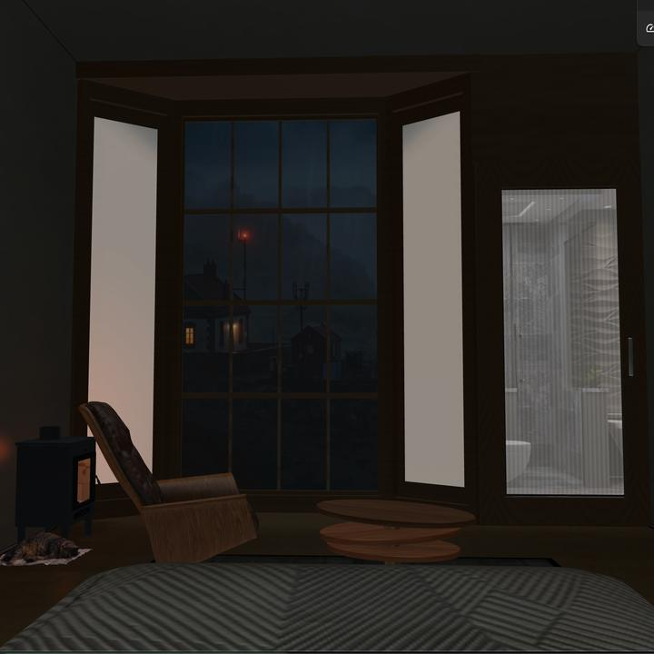

# TVRoom

[English](README.md) · [日本語](README.ja.md) · [简体中文](README.zh-CN.md)

**ゆっくり過ごすための、インタラクティブな部屋。**

家具のある3D空間を歩き、動画を見たり、ノートを読んだり、歩き回る猫と過ごせます。PlayCanvas で作られたブラウザー向けプロジェクトです。

## 主な機能

- キーボード・マウス・タッチ操作による一人称視点の探索。
- 動画スクリーン、YouTube オーバーレイ、環境音。
- オブジェクト操作、ノート閲覧、室内の Work パネル。
- ゲームの Settings → Language で English・日本語・简体中文などに切り替え。設定はブラウザーに保存されます。

## はじめ方

このリポジトリは **PlayCanvas Editor のプロジェクトアーカイブ**です。直接起動できる Web サイトではなく、`index.html` や npm 開発サーバーは含みません。

1. リポジトリをクローン、またはダウンロードして展開します。
2. Python 3.10 以上を用意し、ルートで `python3 scripts/package_project.py` を実行します。
3. [PlayCanvas](https://playcanvas.com) の Project Dashboard で **Import project** を選び、`dist/TVRoom.zip` をアップロードします。
4. インポートしたプロジェクトの **Main Scene** を開き、**Launch** で起動します。

インポートすると別のプロジェクトが作成されます。[公式ガイド](https://developer.playcanvas.com/user-manual/editor/projects/backup-and-export/)も参照してください。セルフホストには、Editor の Publish / Download から実行用ビルドを出力してください。

## 操作

| 操作 | キー |
| --- | --- |
| 移動 | W / A / S / D |
| 視点 | シーンをクリック後、マウス |
| 速く移動 | Shift |
| しゃがむ | C |
| ベッドに横になる・起きる | ベッド付近で E |
| ポインターの解放 | Esc |

モバイル用のタッチ操作スクリプトも含みます。音声の開始にはクリックやタップが必要な場合があります。外部サイト側で埋め込みが禁止される場合があり、YouTube には通信が必要です。iOS・Android 実機での音声同時再生は引き続き確認が必要です。

## 開発と貢献

Python 3.10 以上と Node.js 20 以上で `python3 scripts/check_project.py` を実行します。アーカイブ参照、文書リンク、ファイルサイズ、JavaScript 構文を検査します。実際のシーン起動や動画再生の検証は含みません。

`project.json` と `scenes.json` は設定とシーン、`assets.json` と `files/assets/` は素材、`thumbnails/` はプレビューです。ID とディレクトリ構造を維持し、素材の変更は PlayCanvas から再エクスポートしてください。

[貢献ガイド](CONTRIBUTING.md#日本語) · [セキュリティ](SECURITY.md) · [第三者素材](THIRD_PARTY_NOTICES.md)

## ライセンス

TVRoom の貢献者が権利を持つ独自の成果物、文書、補助ツールには [MIT License](LICENSE) を適用します。第三者素材・依存関係・継承コードにはそれぞれの条件が適用されます。ライセンス情報の欠落は利用許諾を意味しません。[素材一覧](docs/asset-licenses.json)をご確認ください。
