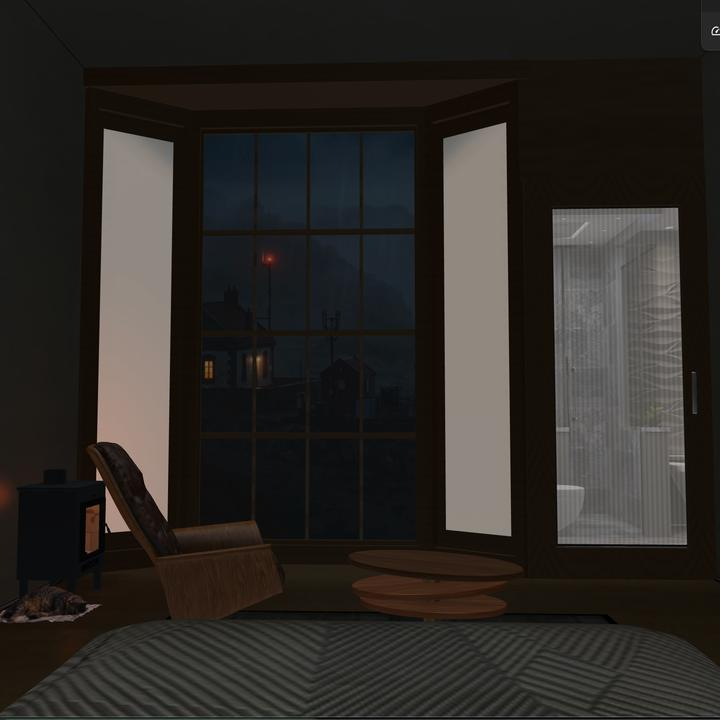

# TVRoom

[English](README.md) · [日本語](README.ja.md) · [简体中文](README.zh-CN.md)

**An interactive room for slowing down.**

Explore a furnished 3D room, watch videos, browse a notebook, and spend time with a wandering cat. Built with PlayCanvas for the browser.

## Features

- First-person room exploration with keyboard, mouse, and touch controls.
- Video screens, a YouTube overlay, and environmental audio.
- Interactive objects, a notebook reader, and an in-room Work panel.
- In-game language selection, including English, Japanese, and Simplified Chinese. Open Settings → Language; the preference is saved locally.

## Getting started

This repository is a **PlayCanvas Editor project archive**, not a standalone website. It has no `index.html` or npm development server.

1. Clone or download this repository and extract it.
2. Install Python 3.10+ and run `python3 scripts/package_project.py` from the repository root.
3. In the [PlayCanvas Project Dashboard](https://playcanvas.com), select **Import project** and upload `dist/TVRoom.zip`.
4. Open the imported project, select **Main Scene**, and use **Launch**.

Importing creates a separate project. See the [official import guide](https://developer.playcanvas.com/user-manual/editor/projects/backup-and-export/). To self-host, export a runnable build from the Editor's Publish / Download panel first.

## Controls

| Action | Desktop |
| --- | --- |
| Move | W / A / S / D |
| Look | Mouse after clicking the scene |
| Move faster | Shift |
| Crouch | C |
| Lie down / get up near the bed | E |
| Release the pointer | Esc |

Touch joystick and button scripts are included for mobile devices. Browser autoplay restrictions may require a click or tap before sound starts. External sites may reject iframe embedding; YouTube requires network access. Audio mixing still needs verification on real iOS and Android devices.

## Development

Run `python3 scripts/check_project.py` with Node.js 20+ and Python 3.10+. The check validates archive references, local documentation links, file sizes, and JavaScript syntax. It does not launch the scene or verify media playback.

Keep the exported asset IDs and directory layout intact. Changes to asset files should be made and re-exported through PlayCanvas so metadata stays in sync.

See [Contributing](CONTRIBUTING.md), [Security](SECURITY.md), and [third-party notices](THIRD_PARTY_NOTICES.md).

## Repository layout

| Path | Purpose |
| --- | --- |
| `project.json`, `scenes.json` | Project settings and scene entities |
| `assets.json`, `files/assets/` | Asset metadata and original files |
| `archive.json`, `devlog.json` | Export metadata |
| `thumbnails/` | Exported previews |
| `scripts/` | Archive validation and ZIP packaging |

## License

The MIT license covers original contributions owned by the TVRoom contributors, including repository tooling and documentation. Third-party assets, dependencies, and inherited code retain their own terms. Missing asset license metadata is **not** a grant of reuse rights. See [LICENSE](LICENSE) and [the asset inventory](docs/asset-licenses.json).
