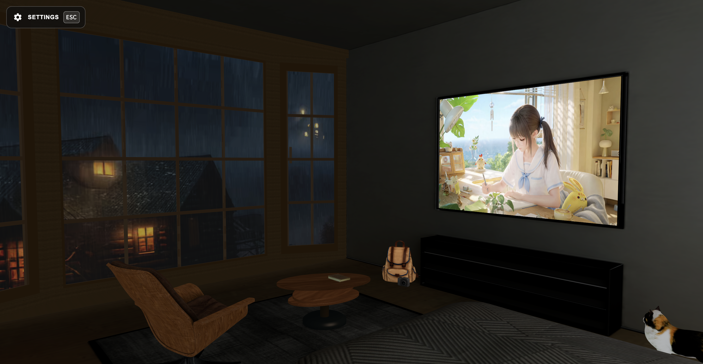

# TVRoom

[English](README.md) · [日本語](README.ja.md) · [简体中文](README.zh-CN.md)

**一个可以慢下来、自由探索的互动房间。**

[▶ 在 YouTube 观看预览效果](https://youtube.com/live/aTu-y6cP5kg)

在布置好的 3D 房间里散步、看视频、翻阅笔记，陪伴四处走动的猫咪。使用 PlayCanvas 构建，面向浏览器运行。

## 项目功能

- 第一人称探索，支持键盘、鼠标和触控操作。
- 视频屏幕、YouTube 浮层与环境音效。
- 物品交互、笔记阅读器和房间内的 Work 面板。
- 游戏内打开 Settings → Language，可选择 English、日本語、简体中文等语言，选择会保存在浏览器中。

## 快速开始

本仓库是 **PlayCanvas Editor 工程归档**，不是可直接托管的网站；不包含 `index.html` 或 npm 开发服务器。

1. 克隆仓库，或下载后解压。
2. 安装 Python 3.10+，在仓库根目录执行 `python3 scripts/package_project.py`。
3. 打开 [PlayCanvas](https://playcanvas.com) 的 Project Dashboard，选择 **Import project**，上传 `dist/TVRoom.zip`。
4. 打开导入的工程，选择 **Main Scene**，点击 **Launch** 运行。

导入会创建独立工程，参见[官方导入说明](https://developer.playcanvas.com/user-manual/editor/projects/backup-and-export/)。需要自行部署时，请先通过 Editor 的 Publish / Download 导出可运行版本。

## 操作说明

| 操作 | 桌面端 |
| --- | --- |
| 移动 | W / A / S / D |
| 转动视角 | 点击场景后移动鼠标 |
| 加速移动 | Shift |
| 蹲下 | C |
| 躺下或起床 | 床边按 E |
| 释放鼠标 | Esc |

工程包含移动端摇杆和触控按钮脚本。浏览器可能要求先点击或触摸才能播放声音；外部网站可能禁止 iframe 嵌入，YouTube 需要网络连接。iOS、Android 实机上的多路音频播放仍需验证。

## 开发与贡献

准备 Python 3.10+ 和 Node.js 20+，执行 `python3 scripts/check_project.py`，检查归档引用、文档链接、文件大小与 JavaScript 语法。该检查不会启动场景，也不能代替真实设备上的媒体播放测试。

`project.json`、`scenes.json` 保存工程和场景；`assets.json`、`files/assets/` 保存素材信息与文件；`thumbnails/` 保存预览。请保留资源 ID 和目录结构，通过 PlayCanvas 修改并重新导出素材，确保元数据同步。

[贡献指南](CONTRIBUTING.md#简体中文) · [安全说明](SECURITY.md) · [第三方素材声明](THIRD_PARTY_NOTICES.md)

## 许可证

TVRoom 贡献者拥有权利的原创内容、文档和辅助工具采用 [MIT License](LICENSE)。第三方素材、依赖和继承的代码保留各自许可。素材没有许可记录不代表可以任意使用，详见[素材清单](docs/asset-licenses.json)。
